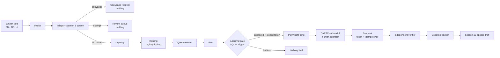

# Architecture

Two independently running services with separate SQLite databases:

| Service | Port | Database | Responsibility |
|---|---|---|---|
| Agent | 8000 | `data/agent.db` | intake, judgment, drafting, approval gate, filing, verification, tracking, dashboard |
| Mock portal | 8001 | `data/portal.db` | application form, CAPTCHA handoff, payment, acknowledgement, transfer, grievance, demo clock |

The verifier reads the portal's confirmation page. It never trusts the filing
response, and it never writes to the portal database. The only shared secret is the
HMAC key used to sign approval tokens.



## Supervisor state machine

`runs.status` moves through:

```
intake
  ├─ awaiting_input ──▶ (answer) ──▶ intake
  ├─ review_queue            (exempt; terminal until a human acts)
  ├─ redirected              (grievance; terminal)
  └─ awaiting_approval
        ├─ declined          (terminal)
        └─ filing ──▶ awaiting_captcha ──▶ filing
              ├─ verified
              ├─ filed_unverified
              └─ failed
verified / filed_unverified
  └─ tracking ──▶ appeal_ready (terminal until the appeal is approved)
```

The supervisor is the only writer of run status. Decision agents return structured
results and write decisions/evidence; they never perform an irreversible action.

## Sequence: TC1 filed and verified

```mermaid
sequenceDiagram
  participant C as Citizen
  participant S as Supervisor
  participant A as Decision agents
  participant DB as agent.db
  participant P as Mock portal
  participant V as Verifier

  C->>S: road repair spending, Pune, 2025-26
  S->>A: intake
  A->>DB: fields + extraction evidence
  S->>A: triage (no exemption; records signal)
  A->>DB: decision rti (rule 6(1))
  S->>A: urgency (no life/liberty)
  S->>A: routing
  A->>DB: registry evidence REG-MH-PWD-01 + retrieved_at
  A->>DB: decision routed (confidence 0.97)
  S->>A: drafting + fee
  A->>DB: draft v1 + rewrite notes; fee Rs 10
  S->>DB: approval row status=pending
  S-->>C: approval card (destination, draft, fee)
  C->>S: approve
  S->>DB: approval status=approved + HMAC token
  S->>DB: INSERT action submit (trigger checks approval)
  S->>P: Playwright fills /apply and submits
  P-->>S: /captcha/{app_id}
  S-->>C: human handoff
  Note over P: demo operator completes CAPTCHA
  S->>DB: INSERT action payment (trigger checks approval)
  S->>P: Playwright pays with token + idempotency key
  P-->>S: /confirmation/MOCK/PWD/R/2026/00001
  S->>V: verify(run)
  V->>P: fresh browser opens confirmation page
  P-->>V: registration number, deadline, filing date
  V->>DB: verifications row (verifier lease required)
  V-->>S: matches intent
  S-->>C: registration number + deadline, observed vs intended
```

## Enforcement points

| Rule | Where | Test |
|---|---|---|
| No payment/submit without an approved approval for the same draft and destination | SQLite trigger `actions_require_approval` | `tests/test_gate.py` |
| One filing per idempotency key | `UNIQUE` index on `actions.idempotency_key`; dedupe in portal `payment_attempts` (accepted only) | gate tests + X7 |
| Approved cards are immutable | SQLite trigger `approvals_locked_after_approval` | gate test |
| Verifier-only writes | SQLite trigger `verifications_verifier_only` + short-lived lease | gate test |
| CAPTCHA never solved | Filing stops at `/captcha`; only an operator endpoint completes it | TC1 / demo |
| Instructions inside the request are data | Injection patterns logged as evidence, sentences stripped before drafting | X5 |
| Exemptions stop filing | `triage` writes `exempt`; supervisor sets `review_queue` | TC3 |

## Why an independent verifier

The filing response is the agent's own view of what happened. It can be wrong,
truncated by a timeout, or optimistic. The verifier therefore:

1. asks the portal for the registration number (read-only status lookup),
2. opens the confirmation page in a **new browser context**,
3. parses the registration number, displayed deadline, filing date and authority,
4. recomputes the deadline from the portal's own filing date and the Section 7(1)
   policy, and
5. writes the result, including a mismatch or pending state, through the verifier
   lease.

If the page is unavailable (X3), the row says `pending`, never `verified`.

## Failure modes and how they are exercised

| Failure | Portal control | Expected agent behaviour |
|---|---|---|
| Timeout after payment | `timeout_next_filing` | One payment; registration recovered by idempotency; verification pending |
| Duplicate submission | idempotent `/apply`; repeated key returns existing app | No second application |
| Duplicate payment | accepted-payment unique index | Existing receipt returned |
| Wrong authority | authority does not match canonical state/department | Portal transfers under Section 6(3); tracker follows |
| Deadline shown wrong | `skew_next_deadline_days` | Verifier records mismatch, not success |
| Evasive reply / no reply | operator reply + advance clock | Section 19 first-appeal draft |
| CAPTCHA | placeholder page | Agent stops; operator handoff |

## Approval token

Signed with HMAC-SHA256 over canonical JSON:

```json
{
  "approval_id": "APR-...",
  "run_id": "RUN-...",
  "draft_id": "DRF-...",
  "fee_inr": 10,
  "destination": "MH-PWD-01",
  "approved_at": "2026-10-19T10:00:00+00:00"
}
```

The portal verifies the signature and checks destination and fee against the
application. It never reads the agent database. `approved_at` gives the ordering
evidence for TC4.

## Deterministic judgment

`agent/nlu.py` holds the multilingual lexicons and patterns. Every label maps to a
named rule, and every routing decision carries a registry source. This is intentional:

- reproducible demo without an API key,
- no model call can bypass the gate,
- the reasoning trail is auditable.

If the plan's Claude tool-use layer is added, it should sit before the deterministic
checks as a suggestion provider, never as the authority for exemptions, fees or the
gate. The evidence ledger is the place to record the suggestion and its source.
